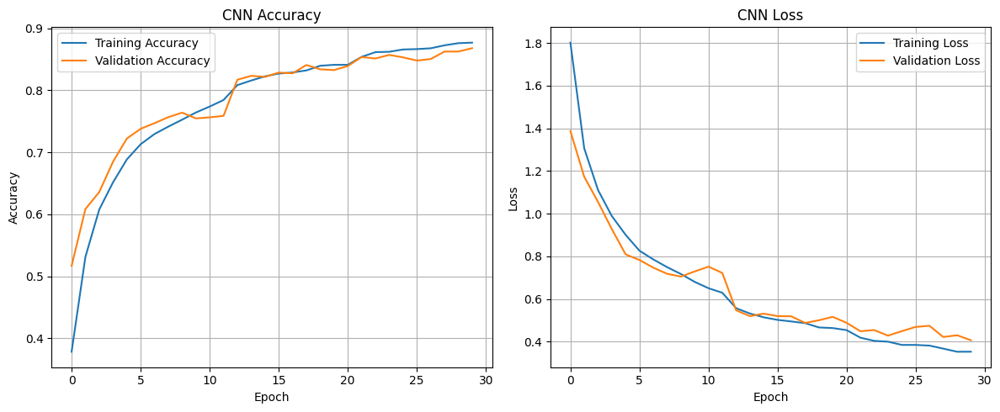
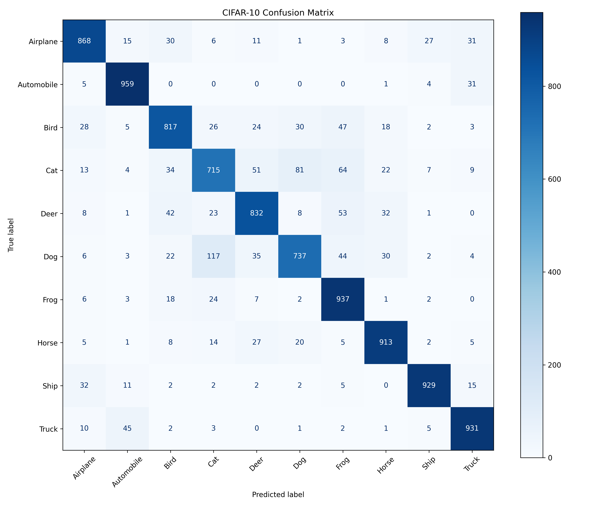
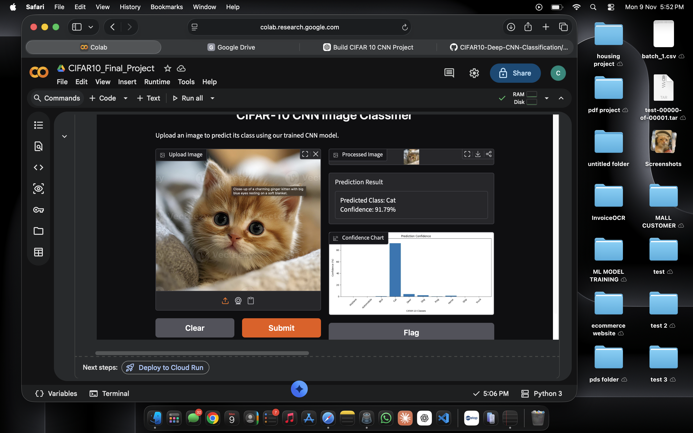

# CIFAR-10 Image Classification using Deep CNN

## Project Overview

This project implements a Deep Convolutional Neural Network (CNN) to classify images from the CIFAR-10 dataset into 10 different categories.

The model was developed using Python, TensorFlow, and Keras in Google Colab.

**Final Test Accuracy: 86.38%**

An interactive web application was also developed using Gradio, allowing users to upload images and receive predictions with confidence scores.

## Dataset

**Dataset:** CIFAR-10

- Total images: 60,000
- Training images: 50,000 (including validation data)
- Testing images: 10,000
- Image dimensions: 32 × 32 pixels
- Color channels: RGB
- Number of classes: 10

### Image Categories

1. Airplane
2. Automobile
3. Bird
4. Cat
5. Deer
6. Dog
7. Frog
8. Horse
9. Ship
10. Truck

## Technologies Used

- Python
- TensorFlow
- Keras
- NumPy
- Matplotlib
- Scikit-learn
- Google Colab
- Gradio
- GitHub

## Model Architecture

The Deep CNN uses multiple layers to extract image features and classify images.

Main components:

- **Conv2D:** Extracts features such as edges, textures, and shapes.
- **Batch Normalization:** Helps stabilize training.
- **MaxPooling2D:** Reduces the spatial dimensions of feature maps.
- **Dropout:** Helps reduce overfitting.
- **Flatten:** Converts feature maps into a one-dimensional vector.
- **Dense:** Learns patterns for classification.
- **Softmax:** Produces prediction probabilities for the 10 classes.

## Project Workflow

1. Load the CIFAR-10 dataset.
2. Convert images into NumPy arrays.
3. Normalize image pixel values.
4. Split the training data into training and validation sets.
5. Build the Deep CNN architecture.
6. Compile the model.
7. Train the model.
8. Monitor training and validation performance.
9. Save the best model using checkpoints.
10. Evaluate the model on unseen test images.
11. Generate a classification report and confusion matrix.
12. Build a Gradio interface for image predictions.

## Model Performance

| Metric | Result |
|---|---|
| Test Accuracy | 86.38% |
| Test Loss | 0.4196 |
| Classification Classes | 10 |
| Test Images | 10,000 |

The model achieved 86.38% accuracy on the CIFAR-10 test dataset.

## Gradio Web Application

An interactive image classification interface was created using Gradio.

### Features

- Upload an image.
- Automatically preprocess the image.
- Predict one of the 10 CIFAR-10 categories.
- Display the predicted class.
- Display prediction confidence.
- Visualize confidence scores using a bar chart.

**Note:** The model is trained on small CIFAR-10 images. Predictions on real-world photographs may be less reliable, and confidence scores do not guarantee correctness.

## How to Run the Project

1. Open `CIFAR10_Final_Project.ipynb` in Google Colab.
2. Install the required Python libraries if necessary.
3. Load the CIFAR-10 dataset.
4. Run the preprocessing and model-building cells.
5. Load the saved trained model from Google Drive.
6. Evaluate the model or launch the Gradio application.

If the saved model is unavailable, training must be completed before evaluation.

## Future Improvements

- Experiment with transfer learning.
- Improve performance on real-world photographs.
- Compare different CNN architectures.
- Add more evaluation visualizations.
- Deploy the application for easier access.

## Conclusion

This project demonstrates the use of Deep Learning and Convolutional Neural Networks for image classification.

The trained model achieved **86.38% test accuracy** on CIFAR-10 and was integrated with an interactive Gradio interface.

---

## Model Performance

The Deep Convolutional Neural Network (CNN) was trained on the CIFAR-10 dataset containing 10 image categories.

### Final Evaluation Results

| Metric | Value |
|--------|-------|
| Test Accuracy | 86.38% |
| Test Loss | 0.4196 |
| Test Images | 10,000 |
| Image Size | 32 × 32 × 3 |
| Number of Classes | 10 |

### Training and Validation Performance

The following graphs show how the CNN model improved during training across 30 epochs.

### Confusion Matrix

The confusion matrix illustrates the classification performance of the CNN model across all 10 CIFAR-10 classes.

### Classification Report

The detailed precision, recall, and F1-score results are available in the [Classification Report](results/classification_report.txt).

---

## Gradio Web Application

An interactive image classification application was developed using Gradio.

Users can upload an image and receive the predicted CIFAR-10 class along with its confidence score.

### Application Screenshot

---

## Conclusion

The Deep CNN model achieved 86.38% test accuracy on the CIFAR-10 dataset.

The project demonstrates image preprocessing, CNN training, model evaluation, and deployment through an interactive Gradio interface.

